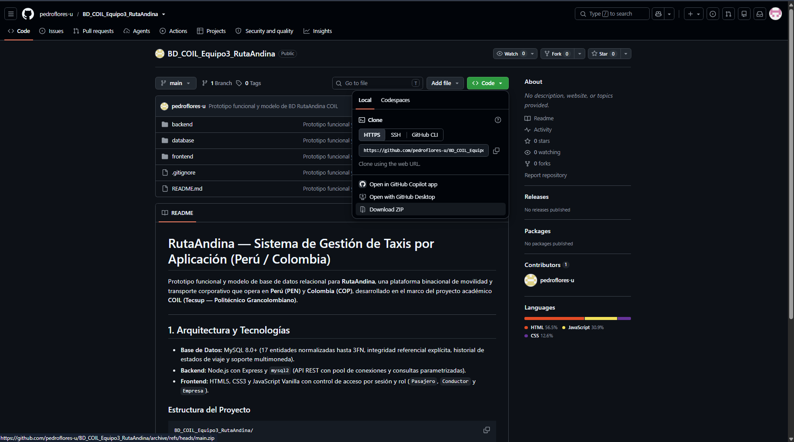
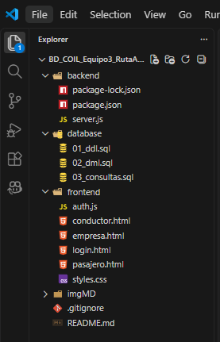
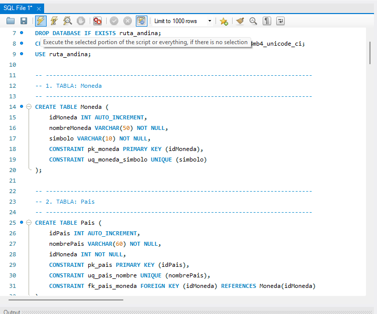
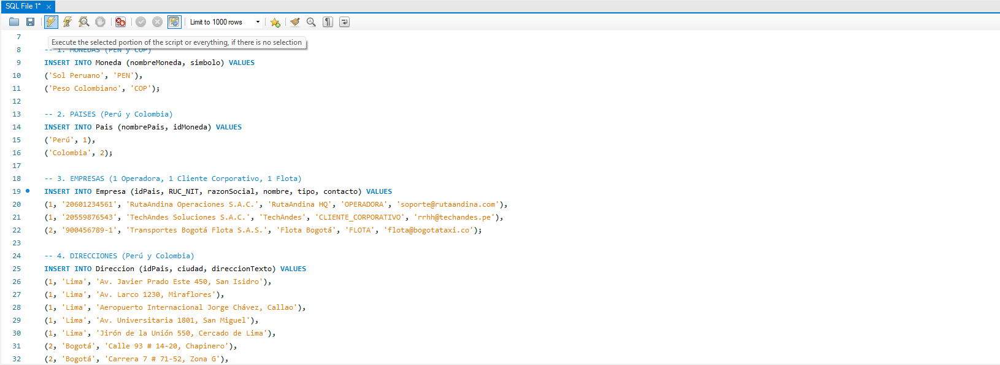
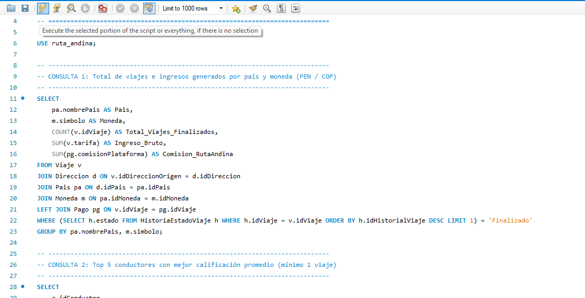
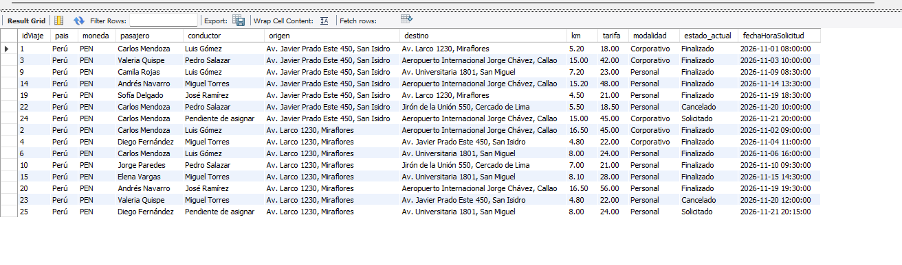
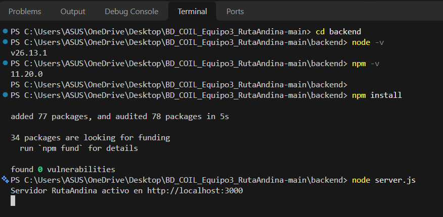
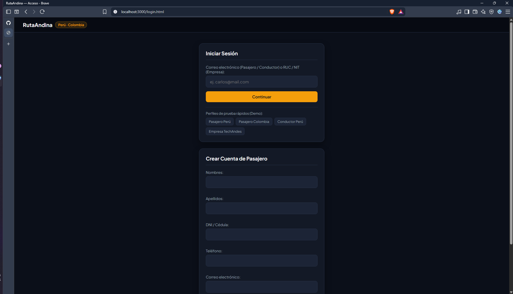
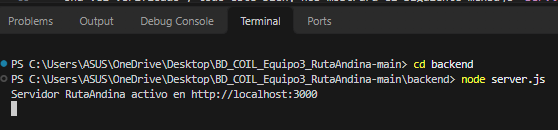

# RutaAndina — Sistema de Gestión de Taxis por Aplicación (Perú / Colombia)

Prototipo funcional y modelo de base de datos relacional para **RutaAndina**, una plataforma binacional de movilidad y transporte corporativo que opera en **Perú (PEN)** y **Colombia (COP)**, desarrollado en el marco del proyecto académico **COIL (Tecsup — Politécnico Grancolombiano)**.

---

## 1. Arquitectura y Tecnologías

* **Base de Datos:** MySQL 8.0+ (17 entidades normalizadas hasta 3FN, integridad referencial explícita, historial de estados de viaje y soporte multimoneda).
* **Backend:** Node.js con Express y `mysql2` (API REST con pool de conexiones y consultas parametrizadas).
* **Frontend:** HTML5, CSS3 y JavaScript Vanilla con control de acceso por sesión y rol (`Pasajero`, `Conductor` y `Empresa`).

### Estructura del Proyecto

```text
BD_COIL_Equipo3_RutaAndina/
├── backend/
│   ├── package.json
│   └── server.js              # Servidor Express y endpoints conectados a MySQL
├── database/
│   ├── 01_ddl.sql             # Creación de esquema y 17 tablas con restricciones
│   ├── 02_dml.sql             # Carga inicial (20 pasajeros, 10 conductores, 10 vehículos, 3 empresas, 50 viajes)
│   └── 03_consultas.sql       # 8 consultas analíticas de negocio + 1 vista consolidada
├── frontend/
│   ├── auth.js                # Protección de rutas por rol en el navegador
│   ├── login.html             # Acceso por perfil y registro de nuevos pasajeros
│   ├── pasajero.html          # Solicitud de viajes (personal/corporativo), historial y calificación
│   ├── conductor.html         # Gestión de solicitudes y flujo de estados (Aceptado -> En curso -> Finalizado)
│   ├── empresa.html           # Reporte y control de consumo mensual corporativo
│   └── styles.css             # Hoja de estilos unificada
└── README.md
```

## 2. Pasos para instalación de la app web

1. Una vez estemos en el proyecto de GitHub. Descargaremos los archivos dando click en 
`<>code` -> `Download ZIP` ->:



2. Una vez descargado, descomprimimos el archivo y abrimos la carpeta en VS Code:



3. Creamos la base de datos:
- Primero entramos a MySQL WorkBench 8.0:
- Luego copiamos el script que se encuentra en "01_ddl.sql" (esta entre los archivos descargados, dentro de Database).
- Pegamos el script en MySQL y damos en el icono del rayo para ejecutarlo:



4. Pruebas:
- Copiaremos y pegaremos el código de 02_dml.sql en MySQL y ejecutaremos:



5. Opcional. Ejecutaremos las 8 consultas analíticas y la vista:
- En el archivo "03_consultas.sql", copiaremos y pegaremos en MySQL, ejecutaremos:





6. Configuraremos nuestra contraseña de MySQL:
- Abriremos VS code.
- Nos dirigiremos a `backend` -> `server.js`.
- En la línea 19, cambiaremos `'body7910'` por nuestra contraseña correspondiente.
- No te olvides de darle `CTRL + S`, para guardar los cambios.

7. Instalación de librerías y prender el servidor (desde la terminal de VS code):
- `CTRL + Ñ` para abrir la terminal en VS Code.
- Verifiquemos que estemos en la `Terminal`. 
- Escribamos los siguientes comando en el mismo orden:
    - cd backend
    - node -v
    - npm -v
    - npm install
    - node server.js
- Verifica con la captura:



- Una vez verificado y todo este bien, nos mostrará el siguiente mensaje *Servidor RutaAndina activo en http://localhost:3000*.
- Podemos copiar `http://localhost:3000` y pegarlo en un navegador.
- Se te abrirá nuestro proyecto, eso verificará que seguiste todos los pasos a la perfección.



***

### ReAbrir el proyecto
En caso se cierre todo (VS Code, el navegador, etc) y al ingresar a *http://localhost:3000* ya no le permita hacer nada, siga los siguientes pasos:
- Abrir la terminal en VS Code.
- Escribir en orden los siguientes comandos:
    - cd backend
    - node server.js



Como se puede dar cuenta, no es necesario seguir todos los pasos desde 0, solo colocar esos 2 comandos y el proyecto volverá a funcionar.
